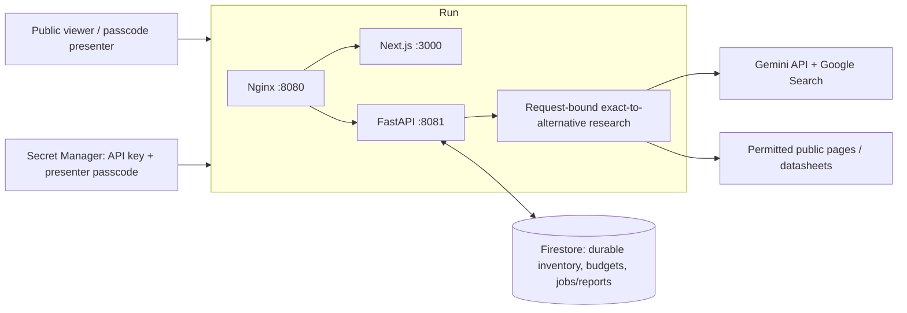

# Simple hackathon deployment: one Cloud Run service

**Recommended path:** Cloud Run serves both Next.js dashboards and the FastAPI backend at **one URL**. Firestore retains inventory and evidence reports across restarts. No Firebase project/web app, Firebase CLI, Google sign-in setup, Cloud Tasks, Scheduler, separate worker or custom domain is required.

This uses **Google free allowances**, not a paid subscription tier. **A billing-enabled Google Cloud project is still required. Zero charges cannot be guaranteed.** Usage beyond allowances, container storage/builds/network traffic and Gemini/Search can incur charges. Billing budgets send alerts; they do not stop spending.

The package has local automated coverage but has **not been deployed to Google Cloud here**. Your account must pass the acceptance checklist below.

## 1. One-time preparation

1. Create/select a Google Cloud project and link billing. Prefer a **new hackathon-only project** so other workloads do not consume allowances. Use `us-central1` for the documented setup.
2. Open **Cloud Shell** in Google Cloud Console, or install [Google Cloud CLI](https://cloud.google.com/sdk/docs/install) on Windows (`winget install --id Google.CloudSDK -e`), **open a new terminal** and run `gcloud auth login`. The deployment script is PowerShell: Windows PowerShell 5.1/PowerShell 7 works. In Linux Cloud Shell, install/use PowerShell first or run the script from Windows; it is not a Bash script. No local Docker, Node or Python installation is needed for deployment builds.
3. In Console, enable **Secret Manager API**, then create these two secrets (automatic replication is fine):

   | Secret name | Value |
   |---|---|
   | `dropin-gemini` | Your Gemini API key with available model and Google Search quota |
   | `dropin-presenter` | A randomly generated **24+ character** presenter passcode; keep it private |

   Use Console's secret value field, not source code, frontend configuration, shell arguments or chat. Each secret needs an enabled version. The script checks only secret metadata and mounts the values at runtime.
4. Set a small billing budget (for example $1 or your preferred amount) with alerts. Review current [Cloud Run](https://cloud.google.com/run/pricing), [Firestore](https://cloud.google.com/firestore/pricing), [Cloud Build](https://cloud.google.com/build/pricing), [Artifact Registry](https://cloud.google.com/artifact-registry/pricing), [Secret Manager](https://cloud.google.com/secret-manager/pricing) and [Gemini limits](https://ai.google.dev/gemini-api/docs/rate-limits). Do not assume a Gemini paid-tier account or switch one on to fix a quota failure.

The deploying account needs permission to enable services, create Firestore/Artifact Registry/service accounts, grant the listed IAM roles, submit Cloud Build jobs, use the runtime/build identities and deploy public Cloud Run services. Project owners commonly have these permissions; organization policy can still prohibit public access. Do not grant Owner to the runtime service account.

## 2. Deploy from the cloned repository

In PowerShell, at the repository root:

```powershell
.\deploy\demo.ps1 -Project "your-project-id" -EnablePublicDocumentResearch
```

If local script execution is blocked, use the process-scoped form:

```powershell
powershell -NoProfile -ExecutionPolicy Bypass -File .\deploy\demo.ps1 `
  -Project "your-project-id" -EnablePublicDocumentResearch
```

The consent switch authorizes permitted public datasheet retrieval and transmission of extracted text to Gemini. Private uploaded PDFs still require separate per-request consent.

That is the only deployment command. The script:

- Enables the required runtime/build/storage and supporting IAM/resource-management APIs.
- Creates the default Firestore Native database if missing (free allowance applies to one eligible database). Existing inventory and reports are preserved on redeploy.
- Creates one Artifact Registry repository and two service accounts: runtime (Firestore + access to the two secrets only) and build (artifact writer, build logs writer and source-object reader).
- Uploads the checkout to Cloud Build; builds one image using [deploy/Dockerfile](./deploy/Dockerfile). Environment files, local inventory and keys are excluded by upload/build ignore files.
- Deploys **`dropin-demo`**, request-based CPU billing, **0 minimum instances / 1 maximum instance**, **1 CPU / 1 GiB RAM**, 10 concurrent requests and a 480-second request timeout. No always-on worker is billed.
- Checks the web page, API health and inventory without spending Gemini quota, then prints your one shareable HTTPS URL.

First builds can take several minutes. If a command fails, resolve the reported permission/quota/configuration error and rerun. IAM propagation may need a short wait. The script does not silently ignore failed provisioning. It does not change an existing Firestore database's location or type; use a compatible project/default Native database.

If your default model IDs are not available, pass one or two exact model IDs from your own AI Studio account:

```powershell
.\deploy\demo.ps1 -Project "your-project-id" -EnablePublicDocumentResearch `
  -GeminiModels "YOUR_SEARCH_CAPABLE_MODEL_ID,YOUR_FALLBACK_MODEL_ID"
```

This is the only supported cloud deployment path.

## 3. Present the demo

1. Open the printed URL. Visitors can view both dashboards, inventory and public research reports without signing in.
2. Enter your presenter passcode in the banner and select **Unlock**. The server validates it. It is held only in browser memory, never in the frontend build or localStorage; refresh requires unlocking again. Share only with trusted presenters/judges. This is shared demo access, not per-user production authentication.
3. Select **Drop PMIC**, or explicitly save stock **below** its safety threshold. The versioned edit atomically persists inventory, reserves a daily job allowance and creates a research record in Firestore.
4. The same HTTP request runs exact-source discovery -> checked sufficient reported exact offer -> otherwise original datasheet -> candidate discovery -> candidate datasheets -> citation-checked comparison. It can take **up to six minutes**. Other tabs poll actual saved stages; stock is never increased by research.
5. Keep the tab open while the request runs. If it fails/disconnects/restarts, refresh inventory. If marked running, select **Resume interrupted research** after its last eight-minute lease expires. No scheduler retries work unattended; a lease permits at most two worker claims before explicit new research is needed. Reset/stock edits invalidate old jobs so late results cannot overwrite new inventory.
6. Review evidence, similarity, unknowns and software/firmware/hardware implications. Download the report. Every alternative stays on engineering hold. A missing/blocked datasheet or quota error remains a failure, never an invented substitute.

Already-below-threshold edits do not automatically call Gemini again. Use the explicit workflow button for a new attempt. Equality with safety stock is in spec.

Defaults: **3 shared research jobs/day and 100 actions/day**, reset at UTC midnight. Uploaded document requests count against the same research allowance (including extraction-only requests). A resumed job consumes an action, not a new job allowance; it can repeat provider operations. A workflow can make multiple provider/model calls, so "3 jobs" does not mean "3 Gemini requests." These are application limits, not a cap on all Google charges.

Public reports/stock are readable by anyone with the URL. Never put confidential input into the public workflow. Existing source allowlists, robots/DNS/HTTPS checks and byte/time limits remain; the app does not bypass blocked websites or provide an unrestricted web scraper.

## Architecture



All browser API calls are same-origin; no separate frontend API URL or authorized-domain/CORS setup. An internal proxy routes `/api/*`, `/health`, `/ready` and API docs to Python and other pages/assets to Next.js. The process supervisor stops the container if any of its three child services exits. There are no separate worker endpoints.

## Staying within free allowances

| Resource | Configuration / important limit |
|---|---|
| Cloud Run | Request-based billing, scales to zero. Published monthly allowance: 2 million requests, 180,000 vCPU-seconds and 360,000 GiB-seconds (us-central1 pricing basis). Cold starts, polling and long research requests consume allowances. Other projects on the billing account share the free tier. |
| Firestore | Default Native database; normal free allowance includes 1 GiB storage, 50,000 reads/day, 20,000 writes/day and 20,000 deletes/day for one eligible database. Polling uses a three-second server snapshot cache. Many cold starts or visitors still increase reads. Backups/PITR/TTL features are not provisioned. |
| Gemini + Search | Separate provider quotas/pricing, not included with Cloud Run. Choose models with available free allowance. Google Search/tool usage may have separate limits/charges. Previous local sourcing returned 429: deployment does not fix it. If no free quota is available, inventory/local extraction can be shown but live research cannot be promised. |
| Build / image storage | Free allowances are small/shared. Rebuilding and retaining multiple large images can exceed them. Only one image is built per deployment; delete old images and uploaded build sources when no longer needed. Image size is not guaranteed to fit Artifact Registry's free storage allowance. |
| Secrets / logs / egress | Two secrets, no key in image. Versions/access, build/runtime logs and outbound traffic have their own limits. Do not enable verbose payload logging or claim all internet egress is free. |

**Not a hard spending cap:** max-instances=1 limits normal scaling, not cumulative runtime, attacks on public reads, provider tokens, build storage or exceptional overlap during deployments. Keep the URL short-lived, restrict who receives the passcode, monitor Billing/Firestore/AI Studio, and delete the demo service when judging ends. Do not pay for a different tier unless you deliberately choose to.

## Acceptance checklist (your account)

- [ ] Open `/`, `/erp-simulator`, `/datasheets`, `/health` and `/api/inventory` at the same URL.
- [ ] An anonymous/wrong-passcode stock POST is rejected; valid passcode unlocks actions. No Firebase popup is needed.
- [ ] In two tabs, a stock edit appears in both; equality with safety stock triggers no job.
- [ ] One below-safety edit produces real persisted research stages and no Tasks/Scheduler resources.
- [ ] With available quota and permitted sources, exact/alternative evidence is saved and visible in both tabs. Missing evidence remains explicit. No stock receipt/order/approval is created.
- [ ] Refresh/redeploy: inventory and completed reports persist. Test interrupted-job Resume after lease expiry with no stale result overwrite.
- [ ] Verify free allowances, billing alerts, provider quota and current image/storage usage.

Offline tests do not prove real IAM, Firestore, Docker runtime, source access or Gemini quota; run this checklist before submitting the URL.

## Update, stop and remove

Redeploy with the same command; Firestore remains. Updating a secret requires an enabled version and redeployment to load it.

Stop public serving after judging (does not delete saved Firestore reports or images):

```powershell
gcloud run services delete dropin-demo --region us-central1 --project YOUR_PROJECT_ID
```

If this was a dedicated disposable project, deleting it in Console is the simplest complete cleanup **after exporting any reports you want**. Otherwise remove only this demo's resources deliberately: Artifact Registry repository `dropin-demo`, build-source objects, the two secrets/service accounts and the app's Firestore documents. Never delete a shared database/project to clean up this demo. Any cloud resources from previous deployments are not removed by source cleanup and may still cost money.
