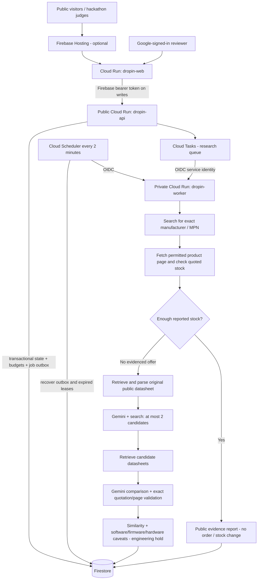

# GCP / Firebase deployment

This package targets a **budget-limited public hackathon demo**, not autonomous procurement or an unrestricted production service. It has not been deployed into a GCP account from this workspace. Follow the acceptance checklist before submitting a URL.

## 1. Architecture and requested flow



- State and jobs survive Cloud Run cold starts in Firestore. Do not use SQLite on Cloud Run.
- Public visitors can inspect inventory and saved public research reports. Google sign-in is required for stock edits, reset, workflow requests and document uploads.
- Any verified Google account is admitted by default. Set `ALLOWED_EMAILS` if you later want an allowlist.
- A stock edit that crosses from `stock >= safetyStock` to **`stock < safetyStock`** enqueues the workflow when automation is enabled. Equality is not a shortage. Edits while already below threshold do not repeatedly spend quota; use the explicit workflow button to retry.
- Exact success requires matching MPN/manufacturer quotes on a fetched page and quoted reported quantity sufficient to restore safety stock. Model interpretation of the page can still be wrong. It is **not** a verified API offer, checkout, reservation or guaranteed stock.
- If no evidenced sufficient exact offer is found, the original datasheet is actually retrieved and its extracted text guides candidate discovery. Each candidate needs its own retrieved, MPN-relevant PDF and checked quotations before appearing as a compared alternative.
- Sources that block crawlers or do not provide usable evidence remain explicit errors. A failed provider call is not evidence of global unavailability. We do not bypass CAPTCHAs, paywalls, authentication, robots policies or source restrictions.
- All substitutions remain held for engineering review. Similarity is an unweighted match fraction of reported comparisons, **not** a probability of interchangeability. Unknown software/firmware effects remain unknown, never implicitly safe.

## 2. Before provisioning (your account)

1. Create a billing-enabled GCP project and add Firebase to that same project in Firebase Console.
2. Enable **Firebase Authentication > Google** and choose a support email. Obtain the Firebase web application's public `apiKey`, `projectId` and `authDomain`. These browser configuration values are not the Gemini secret.
3. Install Google Cloud CLI and Firebase CLI. Sign in on your own machine using `gcloud auth login` and `firebase login`. Do not paste tokens or keys into chat or source files.
4. In Secret Manager, create **`dropin-gemini`**, add an enabled version containing your Gemini key, and confirm billing/quota/search-enabled model access in your provider account. The previous live search test returned 429 on both configured models; deploying does not fix that quota.
5. Use a deployment identity with permission to enable APIs, create Cloud Run/Firestore/Tasks/Scheduler resources, manage the documented service-account IAM bindings, submit builds and deploy Firebase rules. A locked-down organization may require an administrator to provision these instead.
6. Review the terms and robots policy of source domains you permit. Automatic downloading/public evidence publication is deployment-opt-in, not a license to redistribute entire datasheets. Only short evidence excerpts and metadata are retained; original PDF bytes/full extracted pages are not saved.

The script creates billable resources and enables APIs. Review it before running. It does not create a billing account, change organizational policies, purchase provider quota or enable Google sign-in for you.

## 3. Deploy Cloud Run services

From the repository root, with the public Firebase web API key (not the Gemini key):

```powershell
.\deploy\gcp.ps1 `
  -Project "your-project-id" `
  -FirebaseApiKey "your-public-firebase-web-api-key" `
  -EnablePublicDocumentResearch
```

The default region is `us-central1`; use `-Region` for a compatible alternative. `-AuthDomain` overrides the default `your-project-id.firebaseapp.com`. `-GeminiModels` sets at most two ordered provider models.

The script:

- Enables required APIs, creates Firestore Native database if absent, and deploys deny-all browser Firestore rules.
- Creates Artifact Registry and builds both images in Cloud Build. Docker is not required on your machine.
- Creates separate runtime, task identity, build, and unprivileged web service accounts.
- Grants runtime Firestore access, task enqueueing, Firebase user-read access for revoked-token checks, and access only to the named Gemini secret.
- Configures a two-concurrent-task queue with bounded retries.
- Deploys the API publicly, and the worker privately with task-identity-only Cloud Run invocation. Internal routes also validate the OIDC audience and exact service-account email in application code.
- Bootstraps with automatic research disabled, fills the real worker target/audience, then enables automatic public research.
- Creates the two-minute outbox/expired-lease recovery schedule.
- Builds the browser with its API/Firebase configuration; Next public variables are fixed **at build time**.
- Configures API CORS for the Cloud Run frontend and the default Firebase Hosting domains, then checks basic HTTP responsiveness.

IAM propagation can briefly delay newly granted permissions. If a command fails, read the error, resolve permissions/configuration and rerun; do not disable authentication to work around it. Existing jobs and budgets persist across redeployments. A script failure is not a successful deployment.

## 4. Finish Firebase and publish the URL

1. Add the emitted Cloud Run frontend hostname to **Firebase Authentication > Settings > Authorized domains**. Add your chosen Firebase Hosting/custom hostname too. Without this, Google popup sign-in fails with an unauthorized-domain error.
2. Test directly at the emitted Cloud Run frontend URL.
3. For a Firebase Hosting URL:

   ```powershell
   firebase deploy --only hosting --project your-project-id
   ```

   The checked-in Hosting rewrite targets `dropin-web` in `us-central1`. Change the region in [firebase.json](./firebase.json) if you deployed elsewhere; Firebase Hosting only supports its documented Cloud Run integration regions. Do not upload the Next source tree as static hosting.
4. For custom domains, update both Firebase authorized domains and `FRONTEND_ORIGINS` on the API. CORS is not authentication.
5. Restrict the public Firebase web key appropriately in Google Cloud Console and enable Firebase/Auth abuse protection appropriate to your submission. Do not expose the Gemini key in frontend build arguments.

Direct Firestore client reads/writes are forbidden. Firebase Admin/Firestore server libraries use service-account IAM, so the public application configuration cannot grant database write access.

## 5. Configuration and cost limits

| Backend setting | Script/default behavior |
|---|---|
| `STATE_BACKEND=firestore` | Required on Cloud Run; startup rejects ephemeral SQLite |
| `GOOGLE_CLOUD_PROJECT` | Same Firebase/GCP project |
| `GEMINI_API_KEY` | Secret Manager injection, never a browser variable |
| `GEMINI_MODELS` | Up to two provider attempts per operation |
| `AUTO_RESEARCH_ENABLED=true` | Automatically queue threshold crossings |
| `PUBLIC_DATASHEET_CONSENT=true` | Explicit operator permission to process permitted public datasheets with Gemini |
| `PUBLIC_SOURCE_HOSTS` | Allowed domain suffixes; default TI, Analog Devices, NXP, ST, Microchip, Infineon, onsemi, Mouser, DigiKey |
| `BOARD_REQUIREMENTS` | Optional public demo circuit constraints, maximum 8,000 characters; no private design secrets |
| `USER_DAILY_JOBS` / `GLOBAL_DAILY_JOBS` | 3 / 20 accepted workflows or document-processing requests per UTC day |
| `USER_DAILY_ACTIONS` / `GLOBAL_DAILY_ACTIONS` | 40 / 400 mutations/processing requests per UTC day |
| `ALLOWED_EMAILS` | Empty allows verified Google reviewers; optional comma-separated allowlist |
| `TASK_REGION`, `TASK_QUEUE` | Queue location and `research` |
| `TASK_SERVICE_ACCOUNT` | OIDC identity permitted to invoke worker/internal recovery |
| `WORKER_URL`, `WORKER_AUDIENCE` | Actual private worker URL and matching OIDC audience |
| `FRONTEND_ORIGINS` | Exact frontend origins permitted by CORS |

Each accepted job reserves its budget transactionally with the stock update/job outbox. Budget exhaustion rejects the triggering mutation with 429; it does not silently skip automatic research. Duplicate delivery/stock revisions do not charge new jobs. Invalid upload requests can consume a processing budget reservation because authentication/budget checks run before parsing uploaded bytes.

One workflow can make up to **7 provider operations** (exact discovery, at most two page extractions, original discovery, alternative discovery, two comparisons), each with up to two configured model attempts. A process-interrupted job can be claimed a second time, so budgets cap accepted work, not exact monetary cost. Output is capped at 8,192 tokens per operation; input datasheets can still be large. Configure actual Google billing budgets/alerts and provider quotas. Billing alerts are **not hard spend cutoffs**.

- Provider deadline: 45 seconds including capacity wait; transport timeout 20 seconds.
- Workflow deadline: 360 seconds; worker HTTP/task deadline: 600 seconds.
- Worker lease: 480 seconds, refreshed at stages; at most two worker claims.
- Queue dispatch concurrency: 2; worker concurrency: 1; Cloud Run max instances: 2 per service. API/worker memory: 2 GiB each; frontend: 512 MiB.
- Document workflow: 55 seconds; parser: 15-second wall timeout, 10-second CPU and 768 MiB address-space limits on Linux.
- PDF limits: 10 MiB, 120 pages, 160,000 extracted characters; no OCR. Parsing occurs in a killable subprocess without provider credentials.
- Cloud frontend polls every five seconds; API snapshots cache for three seconds per instance. Cross-tab convergence can take roughly eight seconds plus network/scheduling time. Local mode retains one-second polling.
- Public GETs still incur hosting/Cloud Run/Firestore costs. Daily research budgets do not rate-limit public viewing or guarantee resistance to deliberate HTTP abuse. Add edge protection/API quotas for exposure beyond the jury.

## 6. Recovery, privacy and operations

Firestore stores a small shared inventory document, individual job reports, and hashed-UID/day budget counters. No email, Firebase bearer token, entire PDF or full page text is stored in public reports. Public results include MPNs, source URLs, hashes, short quotations, comparison findings and model provenance. Private manually uploaded document results are returned only to their requester and are not saved as public jobs.

Cloud Tasks handles normal delivery; Scheduler repairs a committed outbox whose task enqueue failed, and expired worker leases. Stale/reset jobs cancel before another stage or before persisting results. Terminal jobs are idempotent. Cancellation cannot undo already incurred provider costs. After two interrupted claims, the job records an explicit failure; a reviewer can retry within the budget.

Use Cloud Logging to filter `request_id` / `job_id`. Alert on 429/503 provider errors, failed jobs, long-queued jobs, task backlog, Cloud Run memory failures, Firestore errors and billing. The script creates the schedule, **not a staffed monitoring service or configured alert channels**. Configure those in your project before extended public use.

Choose retention for `research_jobs` and `budgets`, restrict operator access, and take Firestore backups if the demonstration state matters. Expired budget documents no longer affect today's limits but are not automatically deleted. Do not delete current budgets to evade the published cost controls.

This is a shared demonstration: any admitted reviewer can edit/reset the same BOM, and other reviewers will see it. It is not tenant-isolated. Real SAP ingestion, trusted distributor APIs, purchasing, goods receipts and signed engineering approvals remain outside this deployment.

## 7. Mandatory acceptance checks in your project

- [ ] Anonymous inventory/report GETs work; anonymous POSTs return 401, including malformed uploads.
- [ ] Google sign-in succeeds on the actual submission hostname; a revoked/disabled account cannot mutate state.
- [ ] A stock edit exactly equal to safety stock does not queue research; crossing below queues one job.
- [ ] API/worker logs show a real Cloud Tasks invocation; direct unauthenticated worker calls fail.
- [ ] Duplicate task delivery does not run two workers; reset during research prevents late results from attaching.
- [ ] At least one permitted live product page is retrieved; blocked/robots-denied sources remain errors, not invented facts.
- [ ] With available Gemini quota, exercise exact-success and original/candidate-datasheet branches using permitted public documents.
- [ ] Reports show source URLs, document hashes, actual model IDs, exact page quotations, similarity limits and explicit software/firmware/hardware unknowns/changes.
- [ ] Budget exhaustion returns 429 and no provider call; a Cloud Run cold start preserves inventory/jobs.
- [ ] Recovery schedule is active; monitoring/billing alerts and retention are configured.
- [ ] Rebuild the frontend after changing any public API/Firebase variables.

Offline tests use controlled SDK/Firestore implementations, not a live cloud account or an emulator. Cloud IAM, service provisioning, Firebase sign-in and real sourcing require this acceptance pass. The local Docker daemon/Google Cloud CLI were unavailable during preparation, so no container execution or deployment success is claimed.

## 8. Local development

The existing SQLite/manual-research mode remains available without Firebase:

```powershell
cd backend
python -m unittest discover -s tests -v
cd ..\frontend
npm test
npm run lint
npm run build
```

Leave `STATE_BACKEND` at its default and `NEXT_PUBLIC_CLOUD_MODE` unset for local mode. Automatic durable research intentionally requires the cloud configuration rather than a background task tied to a development-server request.

Runtime JavaScript dependency audit passes (`npm audit --omit=dev`). Full dependency audit still reports upstream build-time globbing/CLI advisories with no compatible published braces fix at preparation time. `shadcn` remains a **dev/build dependency** because the stylesheet imports it; forcing an old framework version is not a safe remediation. Recheck patched releases before a broader production rollout.
