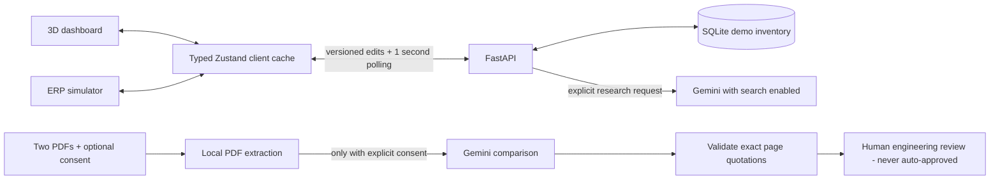

# DropIn.ai

A component-shortage research demo with a local development mode and a GCP/Firebase deployment package: visualize a BOM, simulate shortages, research exact parts, and compare original/alternative datasheets for human engineering review.

## Deploy the automatic workflow on GCP

See **[DEPLOYMENT.md](./DEPLOYMENT.md)** and [deploy/gcp.ps1](./deploy/gcp.ps1) for setup, architecture, IAM, cost controls, Google sign-in, Cloud Run, Cloud Tasks, Firestore and optional Firebase Hosting.

In cloud mode, an edit crossing **below** safety stock automatically queues exact-part research. If sufficient reported exact stock is not evidenced, the worker retrieves an original public datasheet, searches for alternatives using its actual text, retrieves candidate datasheets and checks comparison quotations. Reports list similarity, differences, unknowns, and software/firmware/hardware considerations. Public viewing is open; interactive actions require Google sign-in and obey shared per-user/global budgets.

The deployment package is prepared for you to run; it has **not** been deployed or certified in a GCP account here. Real source access, Google sign-in, IAM and Gemini quota must pass the deployment guide's acceptance checklist. The current provider account previously returned sourcing quota errors.

> Not connected to SAP or live distributor inventory. No purchase orders, stock receipts, OEM escalations, or engineering approvals are created. Research never changes on-hand stock.

## The bigger picture (for a new intern)

A factory needs every BOM component to build its product. When one component's stock reaches its safety threshold, engineers may research the original part or a possible alternative. An alternative must satisfy the actual circuit, firmware, package, and manufacturing requirements; a confident AI answer is not sufficient.

This app has two views of **the same demo inventory**:

- `/`: interactive 3D assembly. Select a component and open the research console.
- `/erp-simulator`: SAP-inspired table for editing stock and reviewing research.
- `/datasheets`: upload two PDFs, extract them locally, and optionally compare their text with Gemini.



The diagram above shows default **local development**. SQLite is its source of truth, not browser localStorage. Cloud deployments instead use Firestore and durable Cloud Tasks workers; their diagram is in the deployment guide. Tabs refresh automatically. Stale edits are rejected rather than overwriting a newer value. Inventory status and research status are separate: an item can have completed research and still be below safety stock. Equality with safety stock is in spec; a shortage means strictly less.

Old browser-local inventory is intentionally not imported or deleted because it may contain stock previously fabricated by research results. The shared demo starts from the canonical BOM and then persists explicit edits in SQLite.

## Run locally

Requirements: Node.js 22+, Python 3.12+, npm, and optionally a Gemini API key.
Inventory and local PDF extraction work without a key.

```powershell
cd frontend
npm ci
cd ..\backend
python -m venv .venv
.\.venv\Scripts\Activate.ps1
pip install -r requirements-dev.txt
```

For Gemini research, create `backend\.env` (never commit it):

```dotenv
GEMINI_API_KEY=your_key
# Optional: ordered model IDs available to your account; at most two are attempted.
GEMINI_MODELS=gemini-3-flash-preview,gemini-flash-lite-latest
```

In separate terminals:

```powershell
cd backend
.\.venv\Scripts\python.exe -m uvicorn app.main:app --host 127.0.0.1 --port 8080
```

```powershell
cd frontend
npm run dev
```

Open <http://localhost:3000>. API docs: <http://localhost:8080/docs>.
`/health` checks service liveness; `/ready` checks configuration, not provider reachability or quota.

Alternatively, from the repository root:

```powershell
.\start.ps1 -Python .\backend\.venv\Scripts\python.exe
```

The launcher uses the selected interpreter, checks dependencies, and waits for HTTP readiness instead of a fixed delay. It reuses responsive services and prints process IDs for newly started services.

### Configuration

| Variable | Purpose |
|---|---|
| `GEMINI_API_KEY` | Backend-only provider credential |
| `GEMINI_MODELS` | Up to two ordered model IDs; availability depends on your account |
| `INVENTORY_DB_PATH` | Optional SQLite path; default `backend\data\inventory.sqlite3` |
| `FRONTEND_ORIGINS` | Comma-separated CORS origins; defaults to localhost/127.0.0.1 port 3000 |
| `NEXT_PUBLIC_API_BASE_URL` | Frontend API origin; defaults to `http://localhost:8080`; set before building |

The default mode is a **single-backend-worker, unauthenticated local demo**; do not expose that mode publicly. Use the authenticated cloud configuration for a public hackathon submission. Neither mode implements production tenancy or enterprise integrations.

## Try the demo

1. Open the ERP simulator and select **Drop PMIC**. Stock becomes 40% of safety stock.
2. Open a second tab. Its stock should match within about one polling interval.
3. Use **Research exact part** or **Research alternatives**. Both dashboards have the same controls; selection/shortage actions do not automatically call Gemini.
4. Review the actual model ID, evidence status, sources (if returned), uncalibrated confidence, timing, and limitations. A quota/tool/model failure is an explicit error, not an invented success.
5. Stock must remain unchanged after research. Only explicit stock edits or **Reset All** change it.
6. Open **PDF comparison**, select documents you have permission to process, and leave consent unchecked to extract locally.
7. If you consent, the two extracted documents and board requirements are sent to Google Gemini. Each returned comparison requires quotations from both PDFs; nonexistent pages or quotations are rejected.
8. All comparisons remain on engineering hold, even when every reported property matches. Verify document revisions, pinout diagrams, register maps, rail requirements, thermal limits, and physical fit yourself.

The ERP **Export inventory CSV** button exports the currently filtered materials; **Print** opens the browser's print flow.

PDF limits: 10 MiB, 120 pages, and 160,000 extracted characters per file. No OCR is configured. The document workflow has a 55-second deadline. Files are not saved by the application; the server's multipart parser may use temporary spool files during a request. Download the evidence JSON if you need to keep a report.

## Project map

- [shared/bom.json](./shared/bom.json): one seed BOM shared by Python and TypeScript.
- [backend/app/main.py](./backend/app/main.py): API boundaries, validation, correlation IDs, inventory routes, and upload workflow.
- [inventory.py](./backend/app/services/inventory.py): SQLite transactions, optimistic revisions, request idempotency, and stale-result guards.
- [gemini_engine.py](./backend/app/services/gemini_engine.py): bounded asynchronous model calls, search evidence, safe normalization.
- [datasheets.py](./backend/app/services/datasheets.py): real PDF extraction, hashes/pages, consent gate, and quotation validation.
- [frontend/src/store/useInventoryStore.ts](./frontend/src/store/useInventoryStore.ts): typed shared client cache and actions; no physical-stock updates from AI.
- [frontend/src/components/](./frontend/src/components/): 3D scene, synchronization, shared research card, and console.
- [frontend/src/app/](./frontend/src/app/): dashboard, ERP, PDF comparison, metadata, and styles.
- [backend/tests/](./backend/tests/), [frontend/tests/](./frontend/tests/): offline regressions using generated synthetic data, not provider quota.
- [.github/workflows/checks.yml](./.github/workflows/checks.yml): backend tests, frontend tests, lint, and build.
- [cloud_state.py](./backend/app/services/cloud_state.py), [identity.py](./backend/app/services/identity.py): Firestore transactions/budgets, Cloud Tasks delivery and verified identities.
- [workflow.py](./backend/app/services/workflow.py), [public_sources.py](./backend/app/services/public_sources.py): exact-to-alternative workflow and bounded robots-aware public retrieval.
- [pdf_extract.py](./backend/app/services/pdf_extract.py), [pdf_worker.py](./backend/app/services/pdf_worker.py): shared extraction and a killable credential-free parser process.
- [deploy/](./deploy/), [firebase.json](./firebase.json): GCP provisioning/builds and Firebase routing/rules configuration.

## Checks

```powershell
cd backend
python -m unittest discover -s tests -v
cd ..\frontend
npm test
npm run typecheck
npm run lint
npm run build
```

See [technical.md](./technical.md) for architecture, contracts, algorithms, latency, concurrency, and limitations. [CHANGE_REPORT.md](./CHANGE_REPORT.md) records the audit and subsequent fixes. Historical findings there describe the pre-fix implementation.
