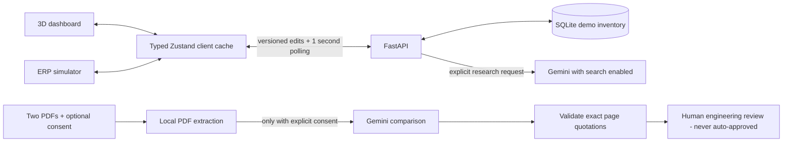

# DropIn.ai

A component-shortage research demo with local development and a single-service Cloud Run deployment: visualize a BOM, simulate shortages, research exact parts, and compare original/alternative datasheets for human engineering review.

## Deploy for the hackathon (Google free allowances)

Use **one Cloud Run service** for both dashboards and the API, plus **Firestore** for inventory and saved reports that survive restarts. No Firebase Auth/web setup, Firebase CLI, Cloud Tasks, Scheduler or separate worker is needed.

1. Create a **billing-enabled** Google Cloud project; in Secret Manager add `dropin-gemini` (API key) and `dropin-presenter` (random 24+ character passcode).
2. Sign in with `gcloud auth login`, then run this from the repository root in PowerShell:

   ```powershell
   .\deploy\demo.ps1 -Project "your-project-id" -EnablePublicDocumentResearch
   ```

3. Open the printed URL and unlock presenter access. Public viewing is open; changes and AI calls need the passcode. A stock edit crossing **below** safety stock automatically runs exact-to-alternative datasheet research during that request. Firestore stores real stages/evidence. Keep the tab open; interrupted work has an explicit Resume action after lease expiry rather than an unattended queue.

See **[DEPLOYMENT.md](./DEPLOYMENT.md)** for the short setup, permissions, free allowances, billing alerts and acceptance checklist. Defaults: scale to zero, max one instance, three shared research jobs/day. **Free allowances are not a spending cap**; builds, storage, network traffic and Gemini/Search have separate quotas/costs. Deployment does not solve the previously observed Gemini 429.

The package has **not** been deployed in a GCP account here. There is one supported cloud architecture and one deployment script.

> Not connected to SAP or live distributor inventory. No purchase orders, stock receipts, OEM escalations, or engineering approvals are created. Research never changes on-hand stock.

## The bigger picture (for a new intern)

A factory needs every BOM component to build its product. When one component's stock reaches its safety threshold, engineers may research the original part or a possible alternative. An alternative must satisfy the actual circuit, firmware, package, and manufacturing requirements; a confident AI answer is not sufficient.

This app has two views of **the same demo inventory**:

- `/`: interactive 3D assembly. Select a component and open the research console.
- `/erp-simulator`: SAP-inspired table for editing stock and reviewing research.
- `/datasheets`: upload two PDFs, extract them locally, and optionally compare their text with Gemini.



The diagram above shows default **local development**. SQLite is its source of truth, not browser localStorage. The recommended cloud demo uses Firestore and request-bound automatic research; its diagram is in the deployment guide. Tabs refresh automatically. Stale edits are rejected rather than overwriting a newer value. Inventory status and research status are separate: an item can have completed research and still be below safety stock. Equality with safety stock is in spec; a shortage means strictly less.

Old browser-local inventory is intentionally not imported or deleted because it may contain stock previously fabricated by research results. The shared demo starts from the canonical BOM and then persists explicit edits in SQLite.

## Run locally

Requirements: Node.js 22+, Python 3.12+, npm, and optionally a Gemini API key.
Inventory and local PDF extraction work without a key.

### One-command Windows setup

From the cloned repository root, in Windows PowerShell 5.1 or PowerShell 7:

```powershell
powershell -NoProfile -ExecutionPolicy Bypass -File .\setup.ps1
powershell -NoProfile -ExecutionPolicy Bypass -File .\start.ps1
```

The [setup script](./setup.ps1):

1. Finds Node.js 22+ and Python 3.12+. If either is missing, installs Node LTS/Python 3.12 using Windows Package Manager (`winget`); installer approval may be requested. Without winget, it stops with manual installation instructions.
2. Creates `backend\.venv` and installs backend runtime/test dependencies there. No Python activation or global pip installation is needed.
3. Runs `npm ci --include=dev` in `frontend` using the committed lockfile.
4. Creates `backend\.env` and `frontend\.env.local` from safe local-mode examples **only when missing**. Existing settings, keys, environments and inventory are not deleted or overwritten.
5. Checks Python dependency consistency/imports, generates Next.js route/environment types for the fresh checkout, and checks frontend TypeScript. A failed command stops setup with an error rather than reporting success.

Internet access and disk space are required. Stop running frontend services before rerunning setup because `npm ci` replaces `node_modules`. Setup does not start servers, call Gemini, request secrets, or provision cloud resources. The default local mode uses SQLite and manual research; automatic request-bound sourcing requires the [cloud deployment](./DEPLOYMENT.md). Existing cloud-configured environment files are preserved, not silently changed into local mode. An incomplete/old virtual environment is reported rather than deleted.

Optional setup controls:

```powershell
# Use an installed interpreter (for example, a Conda installation).
.\setup.ps1 -Python "C:\path\to\python.exe"
# Require preinstalled runtimes; never invoke winget.
.\setup.ps1 -SkipRuntimeInstall
```

If corporate execution policy blocks scripts, use your approved policy/workflow; the command above only bypasses policy for that PowerShell process and does not change machine policy. If runtime installation needs a shell restart, follow the script's explicit instruction and rerun it.

For Gemini research, edit the generated `backend\.env` (never commit it):

```dotenv
GEMINI_API_KEY=your_key
# Optional: ordered model IDs available to your account; at most two are attempted.
GEMINI_MODELS=gemini-3-flash-preview,gemini-flash-lite-latest
```

In separate terminals:

```powershell
cd backend
.\.venv\Scripts\python.exe -m uvicorn app.main:app --host 127.0.0.1 --port 8080
```

```powershell
cd frontend
npm run dev
```

Open <http://localhost:3000>. API docs: <http://localhost:8080/docs>.
`/health` checks service liveness; `/ready` checks configuration, not provider reachability or quota.

Alternatively, from the repository root:

```powershell
.\start.ps1
# Override the default project virtual environment only if needed:
# .\start.ps1 -Python C:\path\to\python.exe
```

The launcher prefers `backend\.venv`, checks dependencies, and waits for HTTP readiness instead of a fixed delay. It reuses responsive services and prints process IDs for newly started services.

### Configuration

| Variable | Purpose |
|---|---|
| `GEMINI_API_KEY` | Backend-only provider credential |
| `GEMINI_MODELS` | Up to two ordered model IDs; availability depends on your account |
| `INVENTORY_DB_PATH` | Optional SQLite path; default `backend\data\inventory.sqlite3` |
| `FRONTEND_ORIGINS` | Comma-separated CORS origins; defaults to localhost/127.0.0.1 port 3000 |
| `NEXT_PUBLIC_API_BASE_URL` | Frontend API origin; defaults to `http://localhost:8080`; set before building |

The default mode is a **single-backend-worker, unauthenticated local demo**; do not expose that mode publicly. Use the authenticated cloud configuration for a public hackathon submission. Neither mode implements production tenancy or enterprise integrations.

## Try the demo

1. Open the ERP simulator and select **Drop PMIC**. Stock becomes 40% of safety stock.
2. Open a second tab. Its stock should match within about one polling interval.
3. Use **Research exact part** or **Research alternatives**. Both dashboards have the same controls; selection/shortage actions do not automatically call Gemini.
4. Review the actual model ID, evidence status, sources (if returned), uncalibrated confidence, timing, and limitations. A quota/tool/model failure is an explicit error, not an invented success.
5. Stock must remain unchanged after research. Only explicit stock edits or **Reset All** change it.
6. Open **PDF comparison**, select documents you have permission to process, and leave consent unchecked to extract locally.
7. If you consent, the two extracted documents and board requirements are sent to Google Gemini. Each returned comparison requires quotations from both PDFs; nonexistent pages or quotations are rejected.
8. All comparisons remain on engineering hold, even when every reported property matches. Verify document revisions, pinout diagrams, register maps, rail requirements, thermal limits, and physical fit yourself.

The ERP **Export inventory CSV** button exports the currently filtered materials; **Print** opens the browser's print flow.

PDF limits: 10 MiB, 120 pages, and 160,000 extracted characters per file. No OCR is configured. The document workflow has a 55-second deadline. Files are not saved by the application; the server's multipart parser may use temporary spool files during a request. Download the evidence JSON if you need to keep a report.

## Project map

- [shared/bom.json](./shared/bom.json): one seed BOM shared by Python and TypeScript.
- [backend/app/main.py](./backend/app/main.py): API boundaries, validation, correlation IDs, inventory routes, and upload workflow.
- [inventory.py](./backend/app/services/inventory.py): SQLite transactions, optimistic revisions, request idempotency, and stale-result guards.
- [gemini_engine.py](./backend/app/services/gemini_engine.py): bounded asynchronous model calls, search evidence, safe normalization.
- [datasheets.py](./backend/app/services/datasheets.py): real PDF extraction, hashes/pages, consent gate, and quotation validation.
- [frontend/src/store/useInventoryStore.ts](./frontend/src/store/useInventoryStore.ts): typed shared client cache and actions; no physical-stock updates from AI.
- [frontend/src/components/](./frontend/src/components/): 3D scene, synchronization, shared research card, and console.
- [frontend/src/app/](./frontend/src/app/): dashboard, ERP, PDF comparison, metadata, and styles.
- [backend/tests/](./backend/tests/), [frontend/tests/](./frontend/tests/): offline regressions using generated synthetic data, not provider quota.
- [.github/workflows/checks.yml](./.github/workflows/checks.yml): backend tests, frontend tests, lint, and build.
- [cloud_state.py](./backend/app/services/cloud_state.py), [identity.py](./backend/app/services/identity.py): durable Firestore transactions/budgets, leases and presenter-passcode verification.
- [workflow.py](./backend/app/services/workflow.py), [public_sources.py](./backend/app/services/public_sources.py): exact-to-alternative workflow and bounded robots-aware public retrieval.
- [pdf_extract.py](./backend/app/services/pdf_extract.py), [pdf_worker.py](./backend/app/services/pdf_worker.py): shared extraction and a killable credential-free parser process.
- [deploy/](./deploy/): one deployment script, Docker image, Cloud Build configuration, proxy and process supervisor.

## Checks

```powershell
cd backend
python -m unittest discover -s tests -v
cd ..\frontend
npm test
npm run typecheck
npm run lint
npm run build
```

See [technical.md](./technical.md) for architecture, contracts, algorithms, latency, concurrency, and limitations. [CHANGE_REPORT.md](./CHANGE_REPORT.md) records the cleanup, validation and remaining go-live gates.
