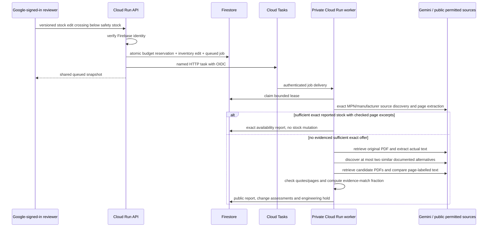
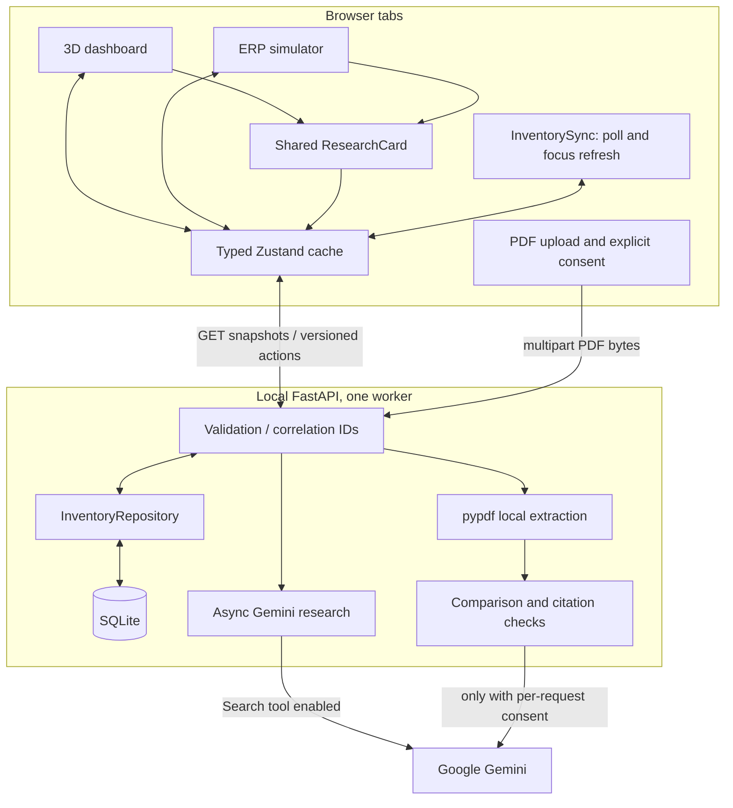
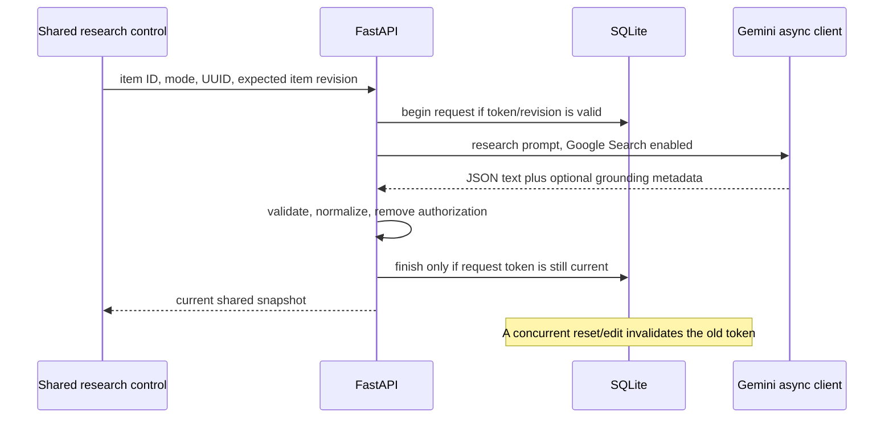
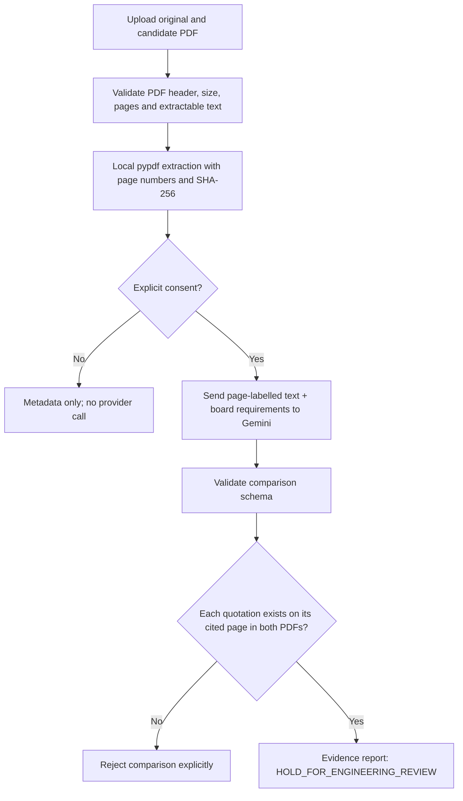

# DropIn.ai technical reference

Current implementation includes local development and a GCP/Firebase hackathon deployment package. Historical defects and results are preserved in [CHANGE_REPORT.md](./CHANGE_REPORT.md). Cloud provisioning/live acceptance has not been executed here; see [DEPLOYMENT.md](./DEPLOYMENT.md).

## Cloud extension: automatic evidence research

The default local mode retains SQLite and manual research. `STATE_BACKEND=firestore` plus a cloud-mode frontend enables the following deployment architecture:



`cloud_state.py` uses one bounded inventory document, separate job documents and hashed-UID/day budget counters. Firestore transaction retries protect concurrent writes; tests use a controlled transactional implementation, not a real emulator. Snapshot reads cache for three seconds per instance; cloud clients poll every five seconds. Startup does not clear live jobs. Cloud Tasks retries, named task deduplication, expiring leases and a two-minute authenticated Scheduler sweep recover dispatch failures/interrupted workers. Recovery task names rotate at fifteen-minute boundaries to avoid exhausted-task tombstones; worker claims remain capped at two. Reset/edit invalidates the job association, preventing stale reports from attaching.

`identity.py` verifies Firebase token signature/project/expiry, revocation, verified email and Google provider on writes. Optional email allowlisting is supported. Worker endpoints require a Google-issued OIDC token for the configured audience and exact task service-account email; the worker Cloud Run service is also IAM-private. Public read routes never expose job inputs, private board requirements, user tokens or user identity. Authenticated uploads are budgeted before body parsing.

`workflow.py` performs real sequential stages, not timer-simulated agent progress. `public_sources.py` applies a permitted-domain HTTPS policy, public-address DNS checks, redirect revalidation, robots disallow/delay checks, byte/time limits and explicit refusal of blocked/non-PDF sources. It does not run an arbitrary crawler or bypass access controls. Approved domains are a trust boundary: an attacker-controlled/rebound domain must not be added; these checks are not a substitute for production egress isolation.

Exact availability is a **reported page observation**, never authoritative distributor stock. Manufacturer/MPN and quantity quotations must appear in the fetched page; a whole-number quantity must cover `max(1, safetyStock-stock)`, with explicit availability wording and no recognized backorder/unavailable wording. AI interpretation and product/quantity context still require review.

The alternative model receives actual original PDF text. Both documents need MPN relevance, hashes, source URLs and extraction. Comparisons validate exact page quotations and reject repeated parameters. Eight change-assessment areas (software, firmware, pinout, power, mechanical, thermal, qualification and timing) default to unknown when unsupported; non-unknown claims require valid comparison-evidence indices. These references do not independently prove model conclusions. Similarity is `100 * match_count / reported_parameter_count`, with unknown comparisons included in the denominator. Missing change assessments keep potential at insufficient evidence even if all reported parameters match. No hard-coded score grants approval.

`pdf_extract.py` contains the shared local parser; `pdf_worker.py` runs it in a credential-free subprocess. Linux limits CPU/address space/file output, and the parent kills a parser exceeding its wall timeout or cancellation. PDF extraction is not OCR, table/diagram certification or complete sandboxing. Private uploads retain per-request consent; automatic public downloads use the operator's explicit deployment opt-in.

Cloud inventory can serve multiple API instances; it is still a shared hackathon BOM, not a multi-tenant ERP. The images, Cloud Build configs, PowerShell provisioning script, Firebase Hosting/rules/index files and deployment acceptance checklist are documented in [DEPLOYMENT.md](./DEPLOYMENT.md). API keys stay in Secret Manager, public Firebase variables are fixed at frontend build time, and Cloud Run rejects SQLite startup.

### Local-mode reference

The numbered sections below describe the local/manual path unless explicitly noted. Cloud behavior above supersedes local-only assumptions about persistence, authentication, polling, automatic triggers and process recovery.

## 1. Purpose and boundaries

DropIn.ai is an evidence-assisted component-shortage prototype. It demonstrates a 3D BOM, a SAP-style inventory table, optional Google Search research through Gemini, and consent-gated comparison of actual PDF text.

It does not connect to SAP, retrieve authoritative distributor stock, reserve/receive goods, dispatch purchase orders, approve an AML, prove pin compatibility, or send OEM escalations. There is no automatic replacement approval, including for high-confidence model responses.

## 2. Technology stack

| Layer | Implementation |
|---|---|
| Web framework | Next.js 16.4 App Router, React 19.3, TypeScript |
| UI | Tailwind CSS 4, Lucide icons; remaining Base UI/shadcn primitive |
| 3D | Three.js, React Three Fiber, Drei (lights/environment/controls/lines/shadows) |
| Client state | Zustand; typed in-memory cache, not localStorage persistence |
| API | FastAPI, Pydantic 2, Uvicorn |
| Persistence | Local SQLite; cloud Firestore transactions and durable Cloud Tasks jobs |
| Cloud identity / hosting | Firebase Google sign-in, Cloud Run API/private worker/web, optional Firebase Hosting |
| Gen AI | Google Gen AI SDK async client; configurable model routing and Google Search tool |
| Documents | pypdf text extraction, SHA-256, Pydantic evidence schemas |
| Quality | Python unittest, Node native test runner, TypeScript, ESLint, Next production build, GitHub Actions |

Some scaffold dependencies/assets remain installed but are not part of the active flow (for example React Flow and Framer Motion). The active sourcing implementation is one prompted research stage, not a multi-agent procurement/engineering pipeline.

## 3. Repository map

```text
shared/
  bom.json                        One ten-component seed BOM
backend/
  app/
    main.py                       API, lifecycle, error boundaries, upload endpoints
    services/
      inventory.py                SQLite persistence and revision/token guards
      gemini_engine.py            Provider calls, provenance, output normalization
      datasheets.py               PDF extraction and exact citation verification
    api/, core/                   Empty compatibility package placeholders
  tests/
    test_api.py                   HTTP validation/error/lifecycle integration tests
    test_inventory.py             Shared-state, reset, duplicate, and restart tests
    test_research.py               Provider/normalization/concurrency tests
    test_datasheets.py             Synthetic PDFs, consent, hashes, citation tests
  requirements.txt                Runtime dependencies
  requirements-dev.txt            Runtime plus HTTP test client
  data/inventory.sqlite3           Runtime demo state, ignored by Git
  datasheets/                     Optional local PDFs, ignored; not auto-submitted
frontend/
  src/
    app/
      layout.tsx                  Metadata, fonts, InventorySync
      page.tsx                    Dashboard shell, navigation, research console toggle
      erp-simulator/page.tsx       Stock table, filters, stock edit forms, shared research card
      datasheets/page.tsx          Two-PDF upload, per-request consent, JSON evidence download
      globals.css                 Tailwind/theme configuration
    components/
      ThreeDBudsPro.tsx            Procedural meshes, springs, projected DOM tooltip, controls
      AIPanel.tsx                  Responsive component selector and shared ResearchCard
      ResearchCard.tsx             Same research controls/result semantics in both dashboards
      InventorySync.tsx            Non-overlapping polling, focus refresh, explicit error banner
      BOMGraph.tsx                Compatibility wrapper around ThreeDBudsPro
      ui/button.tsx               Base UI button variants
    store/useInventoryStore.ts     Typed snapshot guards, stale-snapshot protection, actions
    lib/api.ts                    Configured API origin, JSON errors and client timeout
    lib/utils.ts                  Existing class-name utility re-export
  tests/inventory.test.mjs         Tests actual transpiled store with mocked HTTP
  public/                         Starter SVG assets; favicon is under app/
  next.config.ts                  Shared-repo Turbopack root and Tailwind loader
  eslint.config.mjs               Next/TypeScript lint
  tsconfig.json                   Strict TypeScript and Next route types
  package.json, package-lock.json  Scripts/dependency metadata
  components.json                UI generator metadata
  AGENTS.md                       Next.js development guidance
start.ps1                         Configurable Windows launcher with readiness checks
.github/workflows/checks.yml      Offline tests, lint and production build
README.md                         Intern overview and setup
CHANGE_REPORT.md                  Audit history and fix verification
```

The package `__init__.py` files establish Python imports. Ignore files keep credentials, runtime state, caches, installed dependencies, and local PDFs out of Git. A fresh clone needs dependency installation; no commercial datasheet fixture is required because tests generate original synthetic PDFs.

## 4. System architecture



## 5. Inventory state and concurrency

### Source of truth

[The shared BOM](./shared/bom.json) supplies fixed display metadata and initial stock for ten illustrative components: shell, acoustic mesh, touch film, audio SoC, PMIC, microphone array, IMU, battery, driver, and eartip. These are demo records, not a certified teardown or real SAP material master.

SQLite persists mutable state by component ID:

- `stock`: whole, nonnegative demo on-hand units.
- `revision`: per-item optimistic concurrency token.
- `request_id`, `processing`, `mode`: current/last explicit research request.
- `result`, `error`: recorded research or explicit failure.
- A separate global revision orders full snapshots and protects Reset All.

Every write runs in a short `BEGIN IMMEDIATE` transaction. Connections are explicitly closed. Snapshot reads are transactionally consistent. User actions send only the affected value and expected revision, never a stale full-inventory replacement.

### Update sequence

```mermaid
sequenceDiagram
  participant A as Tab A
  participant API as FastAPI
  participant DB as SQLite
  participant B as Tab B
  A->>API: stock=0, expected_revision=r
  API->>DB: atomically check r and update one item
  DB-->>API: item revision r+1, global revision g+1
  API-->>A: current snapshot
  B->>API: GET inventory (poll)
  API-->>B: updated snapshot
  B->>API: edit using stale revision r
  API-->>B: 409 conflict; refresh and review before retrying
```

Tabs poll one second **after** the preceding poll finishes and refresh on focus. The client applies only snapshots at least as new as the currently applied global revision. A slow older GET cannot roll back a newer POST result. There is no claim of instantaneous or offline synchronization; an unreachable API produces a visible error and disables writes.

Legacy browser localStorage is ignored, not migrated or deleted, because old AI-driven additions may have fabricated on-hand stock. New shared state is seeded from the canonical BOM.

Backend state survives page navigation, reload, and process restart. On startup, orphaned pending requests are marked interrupted with a retry message. Run one backend worker: startup recovery and in-process provider capacity are not a distributed job scheduler.

### Inventory versus analysis

`stock < safetyStock` means a stock exception; equality is in spec. `stock == 0` is line down. A demo shortage sets `floor(safetyStock * 0.4)`.

Research completion is separate. It cannot alter stock, manufacturer/vendor metadata, lead time, description, or the component MPN. There is no `markResolved` or additive replacement-inventory action. A new explicit stock edit clears obsolete research and invalidates pending results for that item.

## 6. Research lifecycle and Gen AI

Both dashboards expose the same explicit **exact** and **alternative** research actions. Selection, shortages, rendering, and reload do not automatically call the provider. Progress says only that a request is running; no artificial agent-stage timeline is displayed.



### Provider behavior

- The API key is checked at call time, not module import. Inventory/liveness/local extraction work without it.
- `GEMINI_MODELS` configures at most two ordered attempts.
- Calls use the SDK's asynchronous transport, with a 20-second HTTP timeout and one SDK attempt.
- A 45-second deadline includes waiting for capacity and model fallback.
- At most two provider operations run concurrently per backend process.
- Search stays enabled for all sourcing model attempts. There is no silent tool-free sourcing fallback or process-global exhausted-model flag.
- Invalid/empty JSON or API errors can try the next configured model. Exhaustion, timeout, and invalid business data produce explicit errors, not fake candidates.
- Grounding URLs/titles come from SDK metadata, not invented model JSON. HTTPS sources are preserved. Source presence does not prove every assertion, current stock, or physical compatibility.
- Response provenance includes the actual successful model, evidence mode, elapsed provider-operation time, and explicit false stock/datasheet-verification fields.

### Algorithms and routing

JSON extraction accepts one object, including simple code fences or surrounding prose, then Pydantic validates types and numeric bounds. Nonfinite/negative quotes and out-of-range confidence are rejected.

Normalization is deterministic:

| Condition | Behavior |
|---|---|
| Exact mode, model identifies the original MPN | Positive reported stock and the matching route can produce an availability-reported route, never approval |
| Exact mode, different or missing model MPN | Discard its quote and return `ENGINEERING_REVIEW_REQUIRED`; never relabel another part's availability as original stock |
| No exact stock / unavailable route | `EXACT_ORIGINAL_UNAVAILABLE`, no catalog link |
| Proprietary/OEM result | `OEM_CUSTOM_ESCALATION`, zero/default quote, no fabricated contact/escalation |
| Missing, same, suffixed-original, or unvalidated alternative | `ENGINEERING_REVIEW_REQUIRED`, no suggested substitution |
| Distinct candidate | Research-only alternative route |
| All routes | `aml_authorization=false`; no order or physical inventory mutation |

Legacy route strings `EXACT_ORIGINAL_PROCURED` and `ALTERNATIVE_ENGINEERED` are retained in response data for compatibility, but the UI describes research, not actual procurement or engineered approval. All non-unavailable/non-OEM outcomes have `HOLD_FOR_ENGINEERING_REVIEW`. Confidence is model self-report, not a calibrated probability or approval threshold.

Positive model-reported availability may get a deterministic DigiKey/Mouser/Avnet **catalog search** URL with an encoded MPN. That is not a product-specific offer, quoted checkout, or API stock verification.

No circuit requirements are available in stock research, so it cannot prove safe substitution. Firmware changes, voltage constraints, missing documents, pinout uncertainty, and OTP differences remain human-review concerns; they cannot be bypassed by high confidence.

## 7. Actual PDF comparison

PDF comparison is a separate, explicit workflow. Stock research does not automatically retrieve PDFs, and neither ignored local sample PDF is implicitly submitted.



Limits per document: 10 MiB, 1-120 pages, at most 160,000 extracted characters. Encrypted, malformed, wholly image/scanned, and empty-text files are rejected; OCR is not configured. Pages without extracted text are identified in the report. Extraction cannot reliably reconstruct every table, pin diagram, equation, or image.

Consent unchecked means local extraction only. Consent checked allows transmission of the extracted text and user requirements to Google Gemini for that request. Users must have permission to process the selected documents; the app cannot determine document confidentiality or redistribution rights. Uploaded PDFs and extracted pages are not saved by the app. Multipart handling may spool uploads temporarily; production retention and provider data-use policy need deployment-specific review.

Each AI comparison contains:

- Parameter, `match`/`difference`/`unknown`, and explanation.
- An original-document citation and candidate-document citation.
- Each citation uses a 1-based PDF page and an 8-400 character excerpt.

The backend verifies page existence and exact excerpt membership after whitespace normalization. It rejects an entire comparison response if any quotation is unsupported. Hashes identify exact input bytes, not a verified manufacturer revision. Document edition, source authenticity, table interpretation, completeness, and conclusions remain unverified.

Even all-match results return `is_drop_in_replacement=false` and `HOLD_FOR_ENGINEERING_REVIEW`. This is quotation-grounded research, **not deterministic electrical compatibility certification**. Board requirements can guide the model but are not a machine-verified circuit model.

## 8. HTTP contracts

FastAPI `/docs` exposes request schemas. Unknown request fields are rejected for JSON business actions. Identifiers are stripped and bounded; inventory/revision values are strict bounded integers.

| Method / route | Behavior |
|---|---|
| `GET /health` | Liveness and honest integration/configuration boundaries |
| `GET /ready` | 503 without provider configuration; does not spend quota checking reachability |
| `GET /api/inventory` | Global revision plus ten typed item states |
| `POST /api/inventory/{id}/stock` | `{stock, expected_revision}`; invalidates old analysis/request |
| `POST /api/inventory/reset` | `{expected_revision}` using the global revision |
| `POST /api/inventory/{id}/research` | `{search_mode, request_id: UUID, expected_revision}`; records research without changing stock |
| `POST /api/webhooks/sap-line-down` | Stateless research compatibility endpoint; accepts MPN/description/mode/demo context, no SAP writeback |
| `POST /api/datasheets/compare` | Multipart `original`, `candidate`, `consent=false`, optional `requirements` |
| `POST /api/evaluate-arbitrage` | 410 Gone; arbitrary path-based PDF evaluation is removed, not faked |

Typical errors: 404 unknown component, 409 stale revision/in-flight research conflict, 422 invalid inputs/documents/citations, 502 invalid provider output/research failure, 503 provider unavailable, 500 unexpected logged server failure.

Every response is correlated with a generated `X-Request-ID`; provider/internal failures expose a reference, not the exception text. CORS allows only configured frontend origins and is **not authentication**.

Research output includes original/candidate MPNs, normalized route, uncalibrated confidence, always-false authorization, status, optional catalog search URL, reasoning/flags/differences, unverified quote, provenance, and timestamp. Purchase-order ID is always null.

Idempotency: resubmitting the current request UUID does not make a second provider call or apply a second result. It is a current-request guard, not an indefinite globally unique transaction ledger.

## 9. 3D rendering and UI

The scene builds procedural meshes from `meshType`: dome/sphere shell, torus acoustic ring, cylinder touch disc/PCB/battery, box semiconductor/sensor/microphones, driver cylinder/coil, and transparent silicone tip. These are illustrative geometry, not manufacturer CAD.

Exploded/assembled x positions are fixed by part ID. `MotionGroup` integrates a damped spring each frame:

```text
force = stiffness * (target - position) - damping * velocity
acceleration = force / mass
velocity += acceleration * dt
position += velocity * dt
dt = min(frame delta, 0.05 seconds)
```

Defaults: stiffness 65, damping 16, mass 1. The delta clamp limits unstable jumps after stalled frames; this is an animation, not a physical simulation.

Critical meshes pulse red with `1.8 + 0.9 * sin(elapsedTime * 5)` emissive intensity and a local point light. OrbitControls support rotate/pan/zoom with bounded camera distance and polar angle; Reset Camera restores its initial state. Lighting/environment is procedural and does not require a remote HDRI.

The tooltip lives in the page's normal DOM tree, not a nested Drei `Html` React root. Each frame, a Three.js group anchor is projected into normalized device coordinates, mapped to canvas pixels, and distance-scaled. It is hidden outside the camera depth range or without selection. Pointer handling does not mutate store-owned records during render.

Both dashboards use the same ResearchCard and backend actions. ERP stock forms require explicit Save, programmatic labels, whole-number constraints, and display stock status separately from research status. CSV export serializes the current filtered inventory with quoted/escaped cells; Print invokes the browser print flow. The console fits its container up to 480 pixels; controls wrap on smaller viewports. Mobile and keyboard smoke checks are not a full WCAG certification.

## 10. Latency, concurrency, and reliability

There is no latency SLA. Sources of delay include provider queueing, model/search latency, PDF extraction, network overhead, and polling.

- Research provider work: at most two simultaneous calls, two model attempts, 20-second HTTP timeout per attempt, and a 45-second overall deadline including the slot queue.
- Client fetch timeout: 60 seconds.
- Shared-state propagation: approximately one polling interval plus request/scheduling time, not real-time push.
- PDF comparison admits two concurrent workflows and has a 55-second deadline including capacity wait, extraction, comparison and evidence checks.
- Local parsing now uses a killable subprocess with a 15-second wall timeout and Linux resource limits. Provider calls use async transport rather than detached worker threads. Broader production upload/network isolation remains a deployment responsibility.
- Short database transactions protect revisions, but SQLite and polling are local-prototype choices, not a high-scale multi-tenant design.

The historical audit measured single exact and alternative requests at 8.828 s and 24.287 s, respectively, under the old routing. These do not benchmark the current implementation. A live synthetic-PDF comparison after the fixes reported 20.868 s provider-operation time with exact page quotes and an engineering hold. The subsequent live sourced-alternative check was blocked by HTTP 429 on both configured models and returned a safe 503; live search success is not currently verified. Provider availability and quotas are account-dependent; an explicit 503 is preferable to ungrounded procurement claims.

No measured p50/p95, throughput SLA, calibrated accuracy benchmark, cost-per-valid-candidate study, or hardware field validation is claimed.

## 11. Tests and operations

Backend tests generate their own small PDFs and stub the provider; no credentials or external quota are needed. They cover numeric/identifier validation, CORS, no-key liveness, provider provenance/cancellation/capacity/deadlines, normalized routes, no automatic authorization, stock-revision conflicts, duplicate requests, late completion after reset, restart recovery, real PDF extraction, consent, and citation rejection.

Frontend tests load the actual TypeScript store through the installed TypeScript compiler and use Node's test runner with mocked fetch responses. They check snapshot validation, out-of-order responses, explicit invalid-input errors, no stock changes from held results, revision conflicts, provider errors, absence of hidden research on selection, reset versus late research, and research versus unfinished stock edits. Type checking and lint remain separate gates.

See the latest section of [CHANGE_REPORT.md](./CHANGE_REPORT.md) for current regression counts, cloud-mode build evidence and external verification limitations.

See [README.md](./README.md) for exact commands and configuration. The Windows launcher resolves a configurable Python interpreter, checks imports, reuses responsive local services, and waits up to 90 seconds for HTTP readiness. It does not install dependencies or use a hard-coded user directory.

## 12. Remaining production boundaries

Remaining beyond the budget-limited hackathon deployment:

- SAP/ERP identity, authorization, tenant/plant ownership, real material master and goods movements.
- Authoritative distributor APIs, signed quotes, inventory reservations, order/receipt integrations.
- Auditable human engineering approval and procurement workflows.
- OCR/image/table-aware verification, manufacturer revision trust, machine-checked board constraints.
- Full production tenancy/ERP data modeling, distributed provider budgets, signed approvals and operating SLAs.
- Edge-level public-view abuse protection, configured monitoring/alert channels, retention/backups and broader isolation/hardening.
- Real-world accuracy, cost, impact, load and accessibility qualification.

Do not expose the unauthenticated local mode to the public internet or use model output as engineering approval. Use cloud mode with the deployment acceptance checklist for a public jury demo. No score/report substitutes for missing enterprise integration and engineering verification.
